# PokeKnomiGochi

[](relay/README.md)

A Pokémon tamagotchi for the **BTT Knomi V2**, the little round screen made for 3D printers. Raise any of the original 151, battle wild Pokémon, catch them to fill your Pokédex, and play mini games by tapping and tilting.

<p align="center">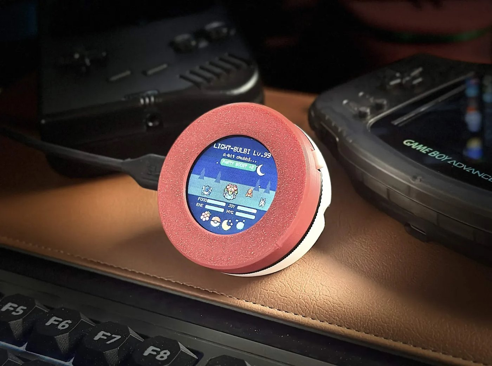</p>

**No Knomi? [Play it in your browser](https://pokewebgochi.3dprintsos.com)** on a computer, phone or tablet, or get the [Mac app](#pokemacgochi-mac) or the [Windows app](#pokewingochi-windows).

This is an adaptation of [**TamaPoke**](https://github.com/socquique/TamaPoke) by Quique Tortosa, who created the original game. PokeKnomiGochi brings it to the Knomi and adds battles, catching and new games. Please give the original a star.

| | | |
|:--:|:--:|:--:|
|  |  |  |
| **Raise your Pokémon** | **Battle wild Pokémon** | **Aim for the green circle** |
|  | 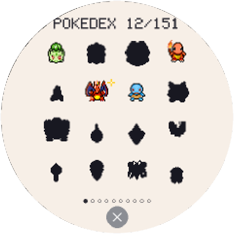 |  |
| **Catch what you beat, 1 to 3 ★** | **Fill the Pokédex** | **Read about what you've caught** |
|  |  |  |
| **Play mini games** | **PokeRun** | **Who's That Pokémon?** |
|  |  |  |
| **Choose where to hunt** | **See what's missing** | **Battle in that zone** |
|  |  |  |
| **Guess the silhouette** | **Tilt Catch** | **A visitor drops by each day** |
| 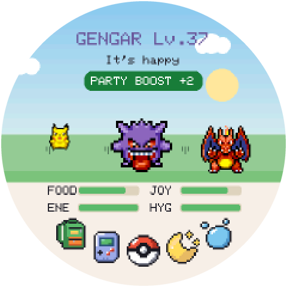 |  |  |
| **Buddies come to visit** | **Battle or trade with them** | **Press and slide to choose** |
| 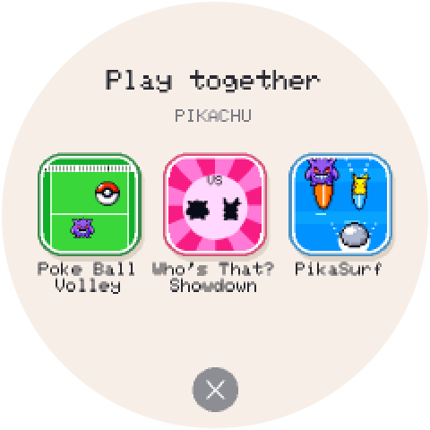 | 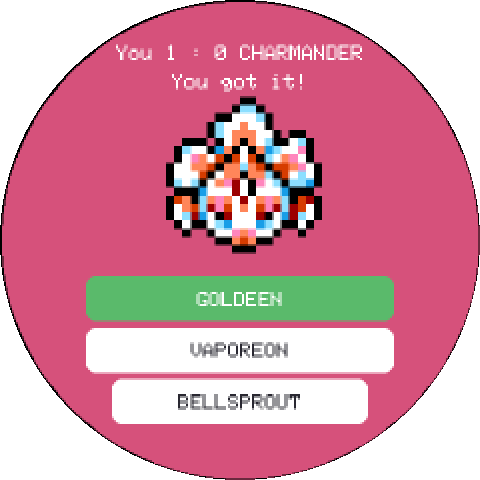 | 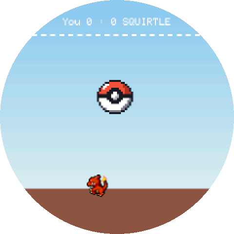 |
| **Play together** | **Who's That? Showdown** | **Poké Ball Volley** |
| 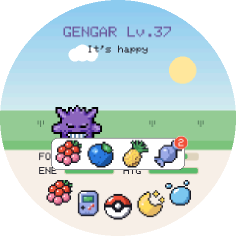 | 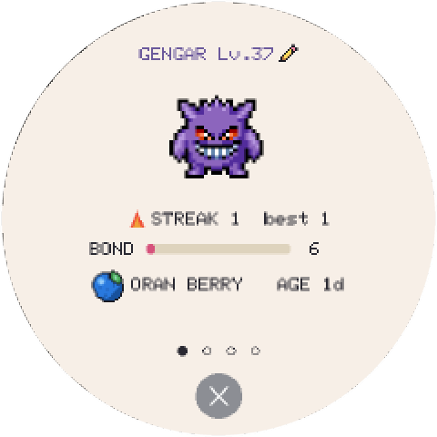 | 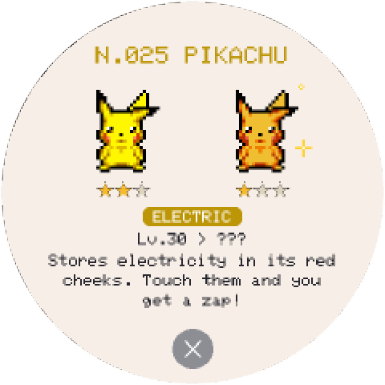 |
| **Feed it berries and candy** | **Its card and favorite berry** | **Catch the shiny ones too** |
| 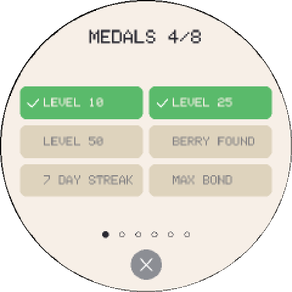 | 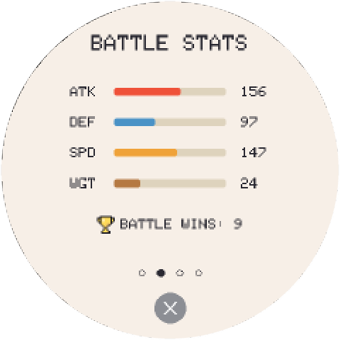 | 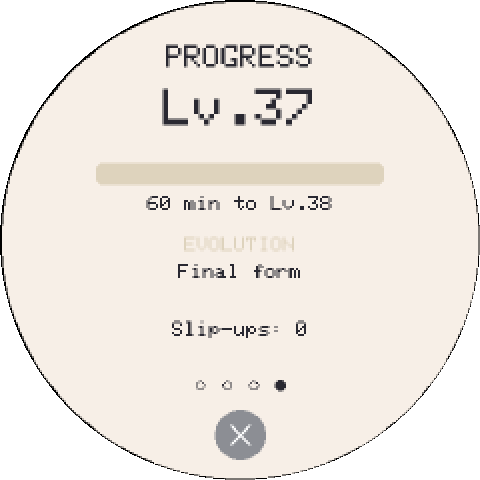 |
| **Achievements, a swipe away** | **Stats, training and battle wins** | **How close it is to evolving** |

## Install

You need a BTT Knomi V2, a USB-C data cable, and Chrome or Edge on a computer.

Don't have a Knomi yet? **[Get the BIGTREETECH Knomi V2](https://www.awin1.com/pclick.php?p=43148197656&a=2034499&m=95665)**. This is an affiliate link from [deals.3dprintsos.com](https://deals.3dprintsos.com): buying through it supports this project at no extra cost to you.

1. Plug in the Knomi.
2. Open the **[web installer](https://fedorsosnin.github.io/PokeKnomiGochi/)** and click **Install**.
3. Pick the USB serial port and wait a few minutes.

**Updating later:** run the installer again and leave **Erase device** unticked. That keeps your Pokémon and your Wi-Fi.

This replaces the printer-status firmware on the Knomi. To return to it, see [Going back to the stock firmware](#going-back-to-the-stock-firmware).

### Install without the browser

Download the files in [`web/knomi/firmware`](web/knomi/firmware), install [esptool](https://docs.espressif.com/projects/esptool/en/latest/esp32s3/installation.html), then run this from that folder with your own port name:

```bash
esptool --port YOUR_PORT write-flash 0x0 bootloader.bin 0x8000 partitions.bin 0xe000 boot_app0.bin 0x10000 firmware.bin 0x610000 sprites.bin
```

### If the install doesn't work

| Problem | Try this |
|---|---|
| No port appears | Use a different USB-C cable, because many only charge. On macOS or Windows you may also need the driver from the [CH340 page](https://www.wch-ic.com/products/CH340.html). |
| The port is busy | Close anything else using it, such as a serial monitor or Klipper. |
| It fails partway | Run it again. A failed install won't damage the Knomi. |
| The clock is wrong | The clock needs Wi-Fi. See [Wi-Fi and the clock](#wi-fi-and-the-clock). |

## How to play

The screen turns to follow however you hold the Knomi. It starts ready for your right hand with the cable going off to the left, so the button is under your finger.

See [How it works](docs/HOW_IT_WORKS.md) for charts of what every action, game and zone does, and [Moves](docs/MOVES.md) for when every Pokémon learns each move, and how strong each one is.

| Do this | What happens |
|---|---|
| **Tap the Pokémon** | Pet it |
| **Tap the bottom icons** | From left to right: open your bag to feed it (a candy refills its energy: 2 a day, 3 when the visitor brings one, and a red number shows how many are left), play mini games, battle, turn the light off for bed, or give it a bath |
| **Tap the round ✕ at the bottom** | Close a menu, the card, the Pokédex or the clock |
| **Press and slide** | The button under your finger shows large above it. Slide to another one if you missed, and lift to choose |
| **Swipe up** | See its card: profile, battle stats, training and progress |
| **Tap its name on the card** (✏️) | Rename it |
| **Swipe from left to right** | Open the Pokédex. The arrows at its sides, or a swipe, turn the pages; tap a Pokémon for its page, and tap it there to give it a pat |
| **Swipe from right to left** | See your achievements: every medal, 6 to a page. A new medal drops in from the top; tap it to see it there |
| **Swipe down** | Set the clock, then swipe left for settings |
| **Press the button** | Start a wild battle |
| **Hold the button for 1–3 seconds** | Turn the screen on or off |
| **Hold the button for 10 seconds** | Asks whether to erase the game and start over |

### Raising your next Pokémon

When your Pokémon is ready to evolve, a red **Evolve** button appears: tap it to evolve, or **Keep** to stay as it is, and the button comes back an hour later. [Moves](docs/MOVES.md) shows the level each species evolves at.

A fully evolved Pokémon that is at least 3 days old offers a goodbye. If you choose to stay together, it won't ask again: whenever you're ready, hold your finger on it to bring the goodbye back. You can also let any Pokémon go by holding your finger on it. Either way, you then choose your next one from your Pokédex. It hatches from an egg, so only first forms can be chosen: Pikachu, not Raichu. A shiny you have shows as its own square with sparkles, and picking it hatches a shiny for sure; a regular one has a 1 in 4 chance of hatching shiny. If you neglect a Pokémon until it runs away, you get a random common egg instead.

Levels stop at **100**, since a Pokémon past that would be too strong to battle; one that is already older stays at 100. For the end game, raising 3, 5 and 10 different Pokémon to level 100 earns the **Level 100 ×3**, **×5** and **×10** medals, on their own page of achievements.

### Battles and catching

Press the button to meet a wild Pokémon in a simple turn-based fight, inspired by the Game Boy games. Every Pokémon fights with its own moves from Pokémon Red and Blue and learns stronger ones as it levels up, and each move shows a little of its type: flames, splashing water, leaves, sparks, ice and more.

Winning trains your Pokémon. Losing earns nothing and leaves it nearly out of energy, so it has to sleep before it can fight again.

**RUN** leaves a wild battle, but 1 time in 20 it fails: the button turns red and says **Couldn't get away!**, and you have to fight it out. A battle with a buddy can always be left.

<p align="center">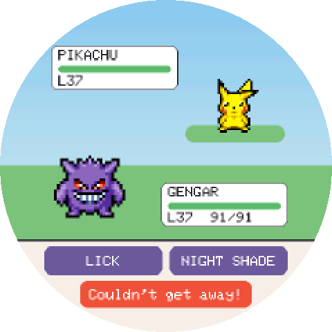</p>

### Moves

Your Pokémon fights with two moves, one on each battle button:

- **Right:** the strongest move of its own type that it knows, like Ember for Charmander.
- **Left:** its strongest move of any other type, like Scratch.

While it knows only one attack, that one gets a single wide button.

It knows every attack its species learns by leveling up in Pokémon Red and Blue, up to its current level, and it gains a level every hour of age, asleep or awake. Only levels teach moves: training and winning don't. When a stronger move takes over a button, the next wild battle opens with **Learned Flamethrower!** A new move that is weaker than the one on its button doesn't replace it.

Charmander, for example, starts with Scratch, learns Ember at level 9, Slash at 30 (in place of Scratch) and Flamethrower at 38 (in place of Ember). After evolving, it follows the new form's list, so a move can come a few levels earlier or later: Charmeleon learns Slash at 33 and Flamethrower at 42. Ditto has no moves of its own: it copies the wild Pokémon's. **[Moves](docs/MOVES.md)** lists every Pokémon's moves, the level it learns each one and each move's power, so you can see whether it pays to wait before evolving.

### Training

Your Pokémon's ATK, DEF and SPD grow as it levels up, and training adds more on top:

- **Winning a battle** adds attack training.
- **Every 6 hours of good care** (every need at 40 or more) adds defense training. Sleep counts, and a need can dip under 40 for up to 15 minutes before the 6 hours start over.
- **Mini games** (Tilt Catch, PokeRun, PokeDungeon) add speed training.
- **Weight** isn't training: food adds it (candy the most), and games, battles and time burn it off. Over 50, your Pokémon tires twice as fast.

Each kind of training stops at 100. The card's **Training** page (swipe up, then left twice) shows how far along each one is, with **MAX** when it's full, and your Pokémon's weight. Once attack training is maxed, a win says so instead of adding more. A new Pokémon starts training from zero.

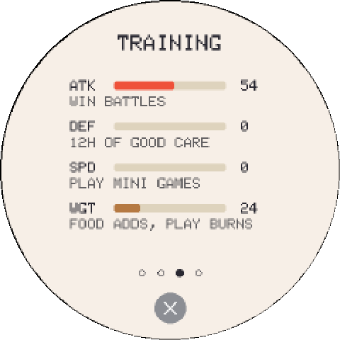

About 1 wild Pokémon in 100 is **shiny**: official shiny colors with gold sparkles around it. The Pokédex keeps shiny and regular forms apart, shows both side by side once you have both, and each can be traded on its own. In the Pokédex grid, a shiny you have moves with its sparkles. Catching everything in a zone earns that zone's medal.

Every wild Pokémon you beat can be caught, even one you already have: you get three Poké Balls, and it runs back and forth across the field trying to get away, at its own speed: a Slowpoke ambles, an Electrode darts, and the quick ones sometimes turn back halfway. Tap to throw, then lean the Knomi left and right to steer. Rings show around the Pokémon as it runs: land the ball in the small green circle and it always holds, in the next ring three times in four, and in the outer ring only one time in four. The ball spins all the way there, then tips over to one side on each count to 3, as if the Pokémon is trying to get out, then the Pokémon joins your Pokédex or breaks out and runs away.

**Stars:** every Pokémon in your Pokédex has 1 to 3 ★, its genes kept simple, and the regular and shiny forms each have their own. Once the ball holds, a screen of its own shows the catch and its stars. A new one goes into your Pokédex; if you already have it and the new one has more stars, it replaces yours. Stars show on each Pokémon's Pokédex page and in trades, a 3★ form gets three small gold stars under it in the Pokédex grid, and they matter when you choose your next Pokémon: picking a 3★ form hatches a 3★ Pokémon, with better stats.

### Battles

Tap the **Poké Ball** icon in the middle of the home screen to pick a zone (Forest, Beach, Cave, Mansion or Field) and hunt the Pokémon that live there. Each zone shows what you've caught and what's still a silhouette. Common Pokémon turn up all the time, rare ones much less often, and each zone's legendary can appear on any Search, but only about once in a hundred. **Wild Encounter**, the last circle, meets a wild Pokémon from anywhere at your Pokémon's home, in the scene of the main screen, just like pressing the physical button. The arrows at the sides of a zone's list, or a swipe, turn its pages. Battles train attack.

### Games

Tap the **handheld** icon, second from the left, to open the mini games: each has a round window onto the game, with your Pokémon in it. They train speed. **Swipe up from the lower half of the screen to quit any game**, with nothing earned.

- **PokeDungeon:** explore a cave floor by floor. Tap toward where you want to step, or hold to keep walking. Walk into a wild Pokémon to attack it with your own best move, pick up Razz, Oran and Pinap Berries to heal, and find the stairs. A better-trained Pokémon gets deeper.
- **PokeRun:** tap to jump over rocks, bushes, fallen logs, stumps and mushrooms in a forest that keeps getting faster. How long can you last?
- **Who's That Pokémon?:** name the silhouette, five rounds per game.
- **Tilt Catch:** in the woods under two tall berry trees, lean left and right to catch falling berries. They fall faster with every catch, with no top speed, so every game ends.

### Buddies

If another PokeKnomiGochi joins the same Wi-Fi network, its Pokémon comes over to play and a green **PARTY BOOST** button appears at the top. Up to 4 buddies can visit at once. Whenever buddies or a daily visitor are around, yours stands in the middle and a size bigger than the rest, so you can always tell which one is yours, even among Pokémon of the same species; the others stand at the sides. Tap a buddy's Pokémon to open the buddy menu for it, and swipe left or right there to switch buddies. Having a buddy earns the **First buddy** medal, and a full party of 5 Pokémon on screen earns **Party of 5**.

- **Battle:** a friendly match where each of you picks your own moves. It makes your Pokémon happy, with no training gained and no energy lost.
- **Trade:** each of you picks a Pokémon from your Pokédex, and a green dot marks ones your buddy doesn't have yet. Once you both confirm, you swap: the one you gave leaves your Pokédex. A shiny is its own square, so you can trade it and keep the regular one. Your own partner can't be traded, so with only one Pokémon, Trade is greyed out. Changed your mind? The **✕** backs out at any point before the swap, and nothing changes hands.
- **Play:** games only buddies can play together, with joy and bond for both afterwards, a bit more for the winner, and the **Playmate** medal.
  - **Who's That? Showdown** shows you both the same silhouette at the same moment: the first to tap the right name gets the point, and a wrong tap is out for that round. 10 questions.
  - **Poké Ball Volley:** your screen is your half of a volleyball court, with the net along the top, and your Pokémon is the paddle; tilt or drag to move, and it runs left and right with you, facing you when it stands still. A ball over the top of your screen drops in on your buddy's. Every shot curves and the ball slowly speeds up, so a match to 3 points lasts about a minute.

### Party Boost

Your Pokémon does better with company. While at least one buddy or the daily visitor is around:

- **Energy drains half as fast.**
- **+2 ATK, DEF and SPD** in wild battles and PokeDungeon.

It's the same boost however many friends are around. Tap **PARTY BOOST** to see who's here and what you get. Tap a friend there to see its stats: level, HP, ATK, DEF and SPD, and a buddy's Pokédex count. Swipe from there to a buddy's Battle, Trade and Play menu, and the ✕ goes back to Party Boost. Tapping a buddy's Pokémon on the main screen still opens its menu first, with its stats a swipe away. While the boost is on, the Battle Stats page shows each stat with its **+2**. Battles between buddies don't use it, since both sides would have it.

| 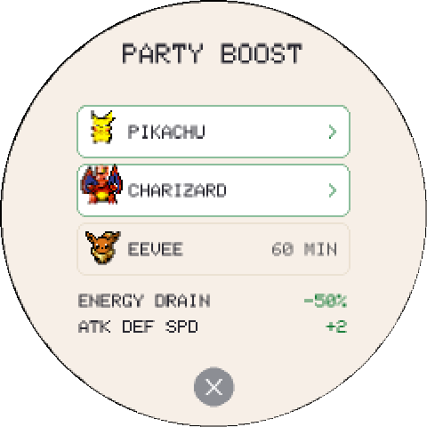 | 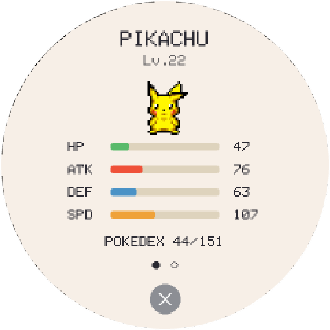 | 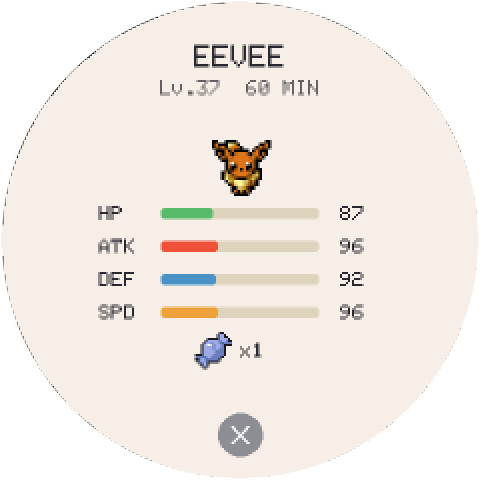 |
|:---:|:---:|:---:|
| **Who's here, and the boost** | **A buddy's stats, then swipe to play** | **The visitor, and its candy** |

To find each other, PokeKnomiGochis share their Pokémon's species, level and nickname and their Pokédex with other devices on the same network. Buddies work between Knomis, the Mac version (PokeMacGochi), the Windows version (PokeWinGochi) and the browser version (PokeWebGochi), in any mix.

### Daily visitor

Once a day, a wild Pokémon drops by with a candy, a third one for that day, and stays for an hour. It joins any buddies in the row, counts for the Party Boost, and shows how many minutes it has left on the Party Boost screen. While your Pokémon sleeps it steps out, and it comes back when yours wakes up, the same day. It remembers its time even if the Knomi is unplugged. When its hour is up, it says goodbye and cheers yours up.

### Wi-Fi and the clock

The Knomi has no clock battery, so it gets the time over Wi-Fi. If it was already on your network, it usually reconnects by itself.

To change networks, swipe down, swipe left, tap **Change Wi-Fi**, pick your network, and type the password on the screen. A new network is only saved once it connects.

The time zone is currently fixed to US Eastern time. You can set the clock by hand from the same screen.

### Updates over Wi-Fi

Once it's on Wi-Fi, the Knomi looks for a new version once a day while the screen is dimmed. To update, swipe down, swipe left, and tap **Check for update**. If a new version is out, the button changes to **Update to v…**: tap it and wait about a minute while it downloads and restarts. Your Pokémon, Pokédex and Wi-Fi are kept. If the new version ever fails to start, the Knomi goes back to the one it had.

On version 1.30 or older, **Update** could fail while buddies were connected through the internet relay: the two secure connections didn't fit in memory together. If yours says "Update failed", install 1.31 or newer once with the [web installer](https://fedorsosnin.github.io/PokeKnomiGochi/) and a USB cable, without ticking "Erase device". It keeps your Pokémon, and from then on updates over Wi-Fi work.

## 3D-printed case

A Poké Ball case for the Knomi, ready to print in three colors. It's a remix: the front half comes from [Knomi V2 Creality K1 wall holder / table stand](https://www.printables.com/model/850244-knomi-v2-creality-k1-wall-holder-table-stand) by [Nastra](https://www.printables.com/@Nastra_283431) on Printables, and the button and rounded back are new. Both the original and this remix are shared under [CC BY-NC 4.0](https://creativecommons.org/licenses/by-nc/4.0/): free to print, share and remix with credit, but not to sell. Download [`PokeKnomiGochi-case.3mf`](print/PokeKnomiGochi-case.3mf).

| | |
|:--:|:--:|
|  |  |
| **Printed and in hand** | **On the desk** |
|  |  |
| **Render** | **Parts in their recommended colors** |

| Part | Recommended color | Size |
|---|---|---|
| Front ring and button | Red (`#D41721`) | 55 × 55 × 6 mm |
| Ball | White (`#FFFFFF`) | 55 × 55 × 29.3 mm |
| Band | Black (`#111111`) | 53.1 × 55 × 5.3 mm |

## Going back to the stock firmware

BIGTREETECH publishes the original firmware and instructions in its [KNOMI repository](https://github.com/bigtreetech/KNOMI). Installing it removes the game.

If you'd like an exact copy of your Knomi before you start, back it up first. The file includes any saved Wi-Fi password, so keep it private:

```bash
esptool --port YOUR_PORT read-flash 0 ALL knomi-backup.bin
```

## Build it yourself

The project builds with [arduino-cli](https://arduino.github.io/arduino-cli/) and ESP32 core 3.3.10. The folder has to be called `PokeKnomiGochi`, because Arduino requires the folder to match the sketch name.

```bash
git clone https://github.com/FedorSosnin/PokeKnomiGochi.git
```

```bash
cd PokeKnomiGochi
```

```bash
arduino-cli config init --additional-urls https://raw.githubusercontent.com/espressif/arduino-esp32/gh-pages/package_esp32_index.json
```

```bash
arduino-cli core update-index
```

```bash
arduino-cli core install esp32:esp32@3.3.10
```

```bash
arduino-cli lib install "GFX Library for Arduino" SensorLib XPowersLib U8g2
```

```bash
bash tools/build_knomi_web.sh
```

The build needs Python 3 and writes the flashable files to `web/knomi/firmware`. On a Mac, `tools/knomi_flash.sh` builds and flashes in one step.

Game rules run on your computer without a board:

```bash
./test/run_tests.sh
```

The code still supports the original Waveshare board that TamaPoke was made for. Its guide is in [`docs/TAMAPOKE-README.md`](docs/TAMAPOKE-README.md), and that document also explains the game's numbers in depth.

## PokeWebGochi (browser)

**[Play in your browser](https://pokewebgochi.3dprintsos.com)** on a computer, phone or tablet: the same game, with the Knomi screen centered on a black page. Nothing to install. On a phone, **Add to Home Screen** makes it a full-screen app.

| | |
|:--:|:--:|
| 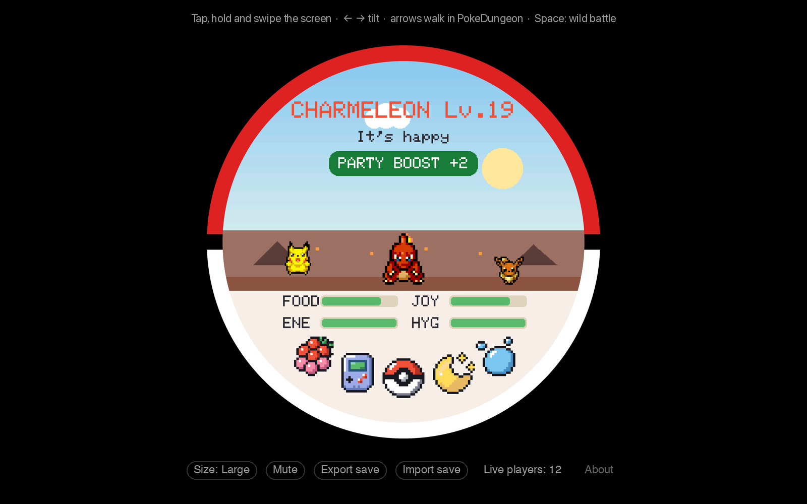 | 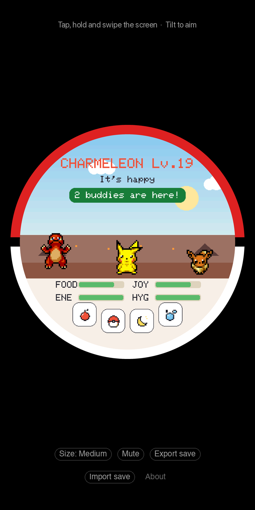 |
| **On a computer** | **On a phone** |

- **Saves:** it saves in the browser by itself. Clearing the browser's data erases it, so use **Export save** now and then for a backup file, and **Import save** to bring a Pokémon back or move it to another browser.
- **One tab at a time:** a second tab offers **Play here**, which moves the game over after the first one saves.
- **Controls:** tap, hold and swipe the screen. On a phone, tilt it to aim (iPhones ask permission once). On Android it also buzzes with taps, meals, medals and catches; **Vibration** under the screen turns that off (iPhone browsers can't vibrate). On a computer, the mouse is a finger that presses when you click, the left and right arrows tilt, all four arrows walk in PokeDungeon, and Space is the Knomi's button.
- **Size:** Small (the default), Medium or Large, like the Mac app. On a small screen it shrinks to fit.
- **Buddies:** browsers can't send the Knomi's local Wi-Fi messages, so they meet buddies through a small relay on the internet that only passes those same messages between devices on the same home network and stores nothing. Knomis and PokeMacGochi use it too, so all three meet each other.
- **Updates:** it updates itself: reload to get the newest version, and a tab left open says when there is one.

To build it yourself, run `webgame/build.sh` (needs [Emscripten](https://emscripten.org)); `tools/publish_web.sh` publishes it. The relay's code is in [relay/](relay/).

## PokeMacGochi (Mac)

The same game as a small round window on your Mac desktop, in a Poké Ball ring. It has no Dock icon; it lives in the menu bar. It needs an Apple silicon Mac (M1 or later) with macOS 12 Monterey or newer.

1. Download `PokeMacGochi.dmg` from the [latest release](https://github.com/FedorSosnin/PokeKnomiGochi/releases), open it and drag **PokeMacGochi** to **Applications**.
2. Open it once. macOS warns that it can't check the app, because it isn't signed by an Apple developer account. Click **Done**.
3. Go to **System Settings → Privacy & Security**, scroll down and click **Open Anyway** next to PokeMacGochi. After that it opens normally.

   Or, in Terminal: `xattr -dr com.apple.quarantine /Applications/PokeMacGochi.app`

**Controls:** click, hold and swipe like a touch screen. The left and right arrows tilt, for Tilt Catch and throwing Poké Balls, and all four arrows walk in PokeDungeon. Space is the Knomi's button, for a wild battle. Drag the red and white ring to move the window: it grows when the mouse is over it, so it's easy to grab, and the screen inside is only for touching, with the mouse as a finger. Right-click it, or click the Poké Ball in the menu bar, for About, Size, Mute Sound, Check for Updates and Quit.

Your pet, sound setting and window size and place are saved on the Mac in `~/Library/Application Support/PokeMacGochi`, separate from any Knomi. Only one copy runs on that save at a time: opening it again just tells you it's already open.

**Updates:** PokeMacGochi checks for a new version when it opens and once a day, and tells you once when one is out. **Download** gets the new DMG; quit PokeMacGochi, open the DMG and drag it into Applications, choosing **Replace**. Your pet stays, since it's saved outside the app.

**Buddies:** a Knomi or another PokeMacGochi on the same Wi-Fi shows up as a buddy, just like between two Knomis. The first time, macOS asks whether PokeMacGochi may find devices on your local network: click **Allow**. If you clicked **Don't Allow**, turn PokeMacGochi on in **System Settings → Privacy & Security → Local Network** and reopen it.

To build it yourself, run `mac/build_dmg.sh` (needs Xcode's Command Line Tools). [host/README.md](host/README.md) explains how it works.

## PokeWinGochi (Windows)

The same game as a small round window on your Windows desktop, for Windows 10 and 11. It's one file with nothing to install, it has no taskbar button, and it lives in the taskbar's notification area (the icons by the clock).

1. Download `PokeWinGochi.exe` from the [latest Windows release](https://github.com/FedorSosnin/PokeKnomiGochi/releases) and put it somewhere you'll keep it, like your Desktop or Documents.
2. Open it. Windows warns that it **protected your PC**, because the app isn't signed by a paid developer certificate. Click **More info**, then **Run anyway**. After that it opens normally.
3. The first time, Windows Firewall may ask whether PokeWinGochi can use your network. Allow it on **private networks**, so buddies on your Wi-Fi can find you.

**Controls:** the same as the Mac app. Click, hold and swipe like a touch screen; the left and right arrows tilt, all four arrows walk in PokeDungeon, and Space is the Knomi's button. Drag the ring to move the window: it grows when the mouse is over it, and the screen inside is only for touching. Right-click it, or click the Poké Ball by the clock, for About, Size, Mute Sound, Check for Updates and Quit. To start it with Windows, put a shortcut to it in the Startup folder (press Win+R and type `shell:startup`).

Your pet, sound setting and window size and place are saved in `%APPDATA%\PokeWinGochi`, separate from the app; the game's pictures are unpacked to `%LOCALAPPDATA%\PokeWinGochi`. Only one copy runs on that save at a time.

**Updates:** it checks for a new version when it opens and once a day, and tells you once when one is out. Quit PokeWinGochi, download the new `PokeWinGochi.exe` and put it in place of the old one. Your pet stays.

**Tilt and controllers:** a controller's left stick tilts smoothly (for Tilt Catch and aiming Poké Balls), and the stick or D-pad walks in PokeDungeon: the built-in one of a handheld PC like the ROG Ally, or an Xbox controller. If Windows has a motion sensor, as many tablets do, tilting the device tilts the game, like on a phone; **Tilt with the Device** in the menu turns that off. On a ROG Ally, set the gyro to act as the left joystick in Armoury Crate, and tilting the Ally tilts the game. The controller and the sensor only count while PokeWinGochi is the active window.

**Vibration:** on a handheld PC with a built-in controller, like the ROG Ally, or with an Xbox controller connected, it buzzes softly with taps, meals, medals and catches. **Vibration** in the menu turns it off; it only shows when a controller is connected.

**Buddies:** Knomis, Macs, PCs and browsers find each other, the same as the Mac app.

To build it yourself, run `windows/build.sh` on a Mac or Linux with [llvm-mingw](https://github.com/mstorsjo/llvm-mingw). [host/README.md](host/README.md) explains how it works.

## Credits and license

- **Game and original firmware:** [TamaPoke](https://github.com/socquique/TamaPoke) by Quique Tortosa and its contributors.
- **Sprites:** the community artists of [PMD SpriteCollab](https://github.com/PMDCollab/SpriteCollab), under CC BY-NC 4.0.
- **Full list:** [`CREDITS.md`](CREDITS.md).

The source code is [MIT licensed](LICENSE). The sprites and Pokémon names are not covered by that license and are for **personal, non-commercial use only**. The 3D-printed case is a remix shared under [CC BY-NC 4.0](https://creativecommons.org/licenses/by-nc/4.0/); see [`CREDITS.md`](CREDITS.md).

This is an unofficial fan project, not affiliated with or endorsed by Nintendo, Game Freak or The Pokémon Company. Pokémon and all related names are trademarks of their respective owners.
