# PokeKnomiGochi

A Pokémon tamagotchi for the **BTT Knomi V2**, the little round screen made for 3D printers. Raise any of the original 151, battle wild Pokémon, catch them to fill your Pokédex, and play mini games by tapping and tilting.

<p align="center">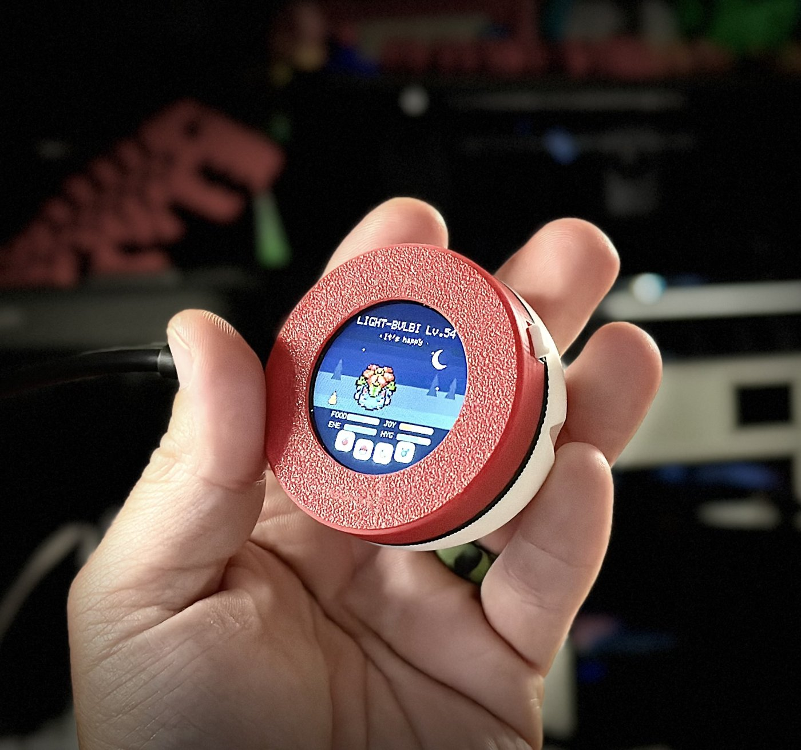</p>

This is an adaptation of [**TamaPoke**](https://github.com/socquique/TamaPoke) by Quique Tortosa, who created the game and did the hard work. PokeKnomiGochi brings it to the Knomi and adds battles, catching and new games. Please give the original a star.

| | | |
|:--:|:--:|:--:|
| 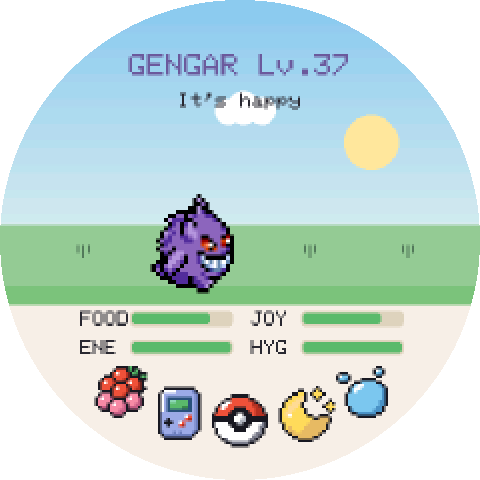 | 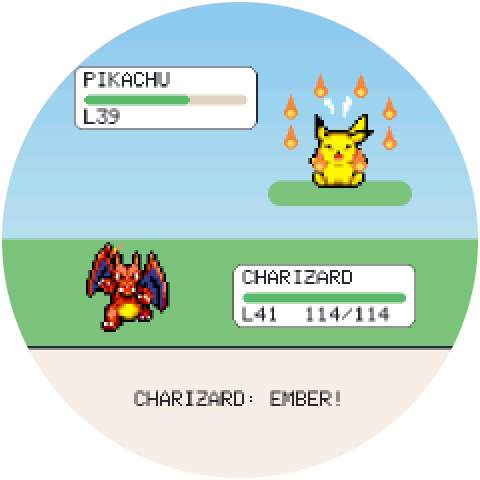 | 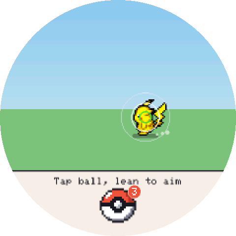 |
| **Raise your Pokémon** | **Battle wild Pokémon** | **Lean to aim your Poké Ball** |
| 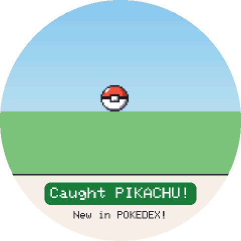 |  | 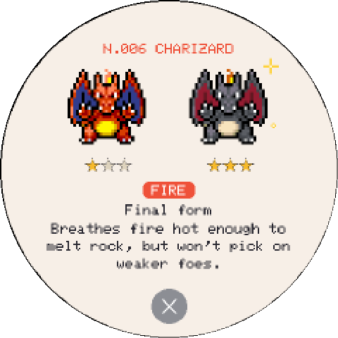 |
| **Catch what you beat** | **Fill the Pokédex** | **Read about what you've caught** |
| 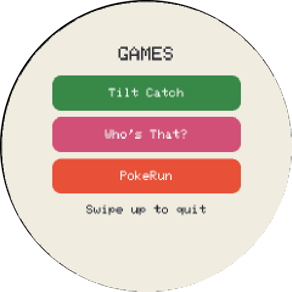 | 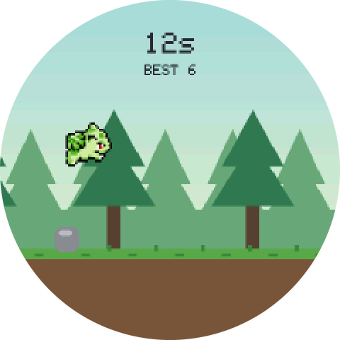 | 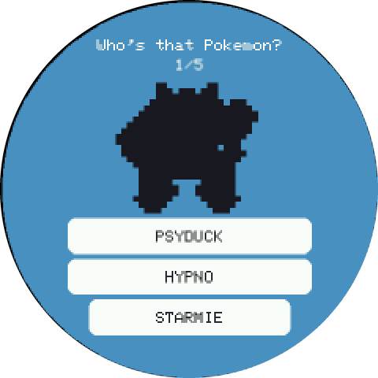 |
| **Play mini games** | **PokeRun** | **Who's That Pokémon?** |
| 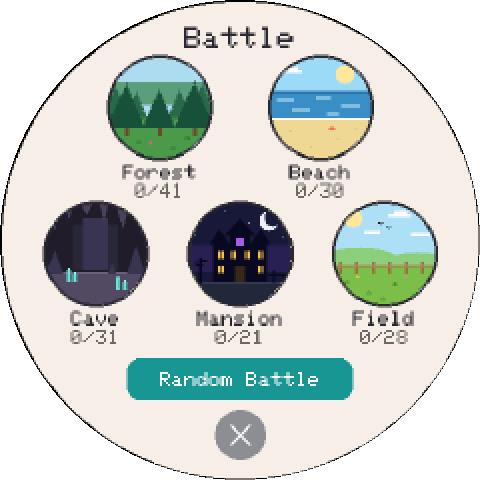 | 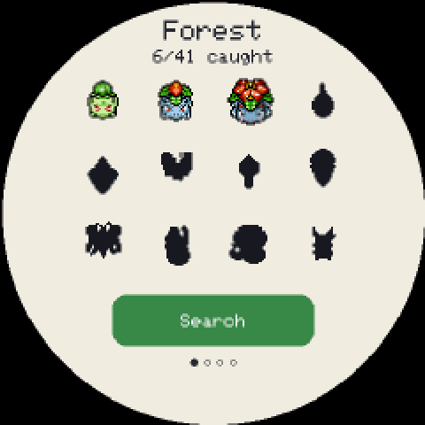 | 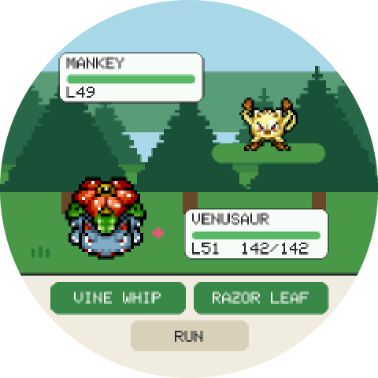 |
| **Choose where to hunt** | **See what's missing** | **Battle in that zone** |
| 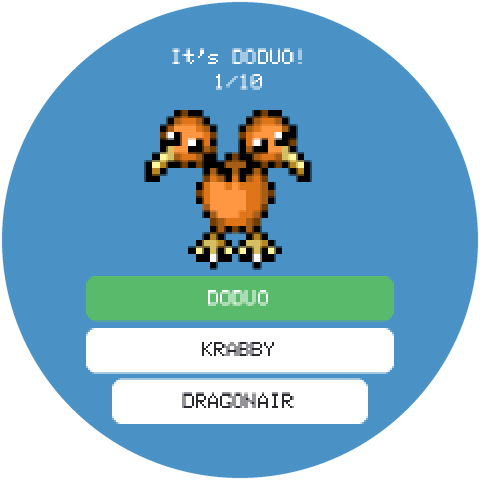 | 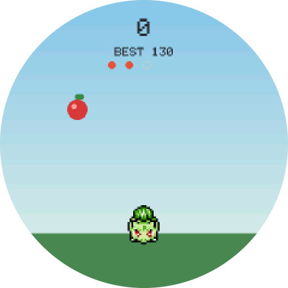 | 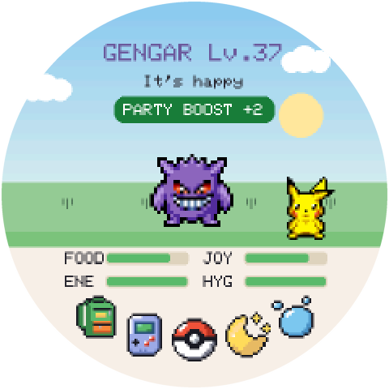 |
| **Guess the silhouette** | **Tilt Catch** | **A visitor drops by each day** |
|  | 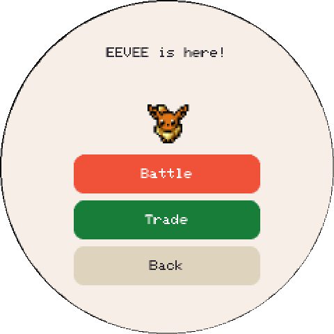 | 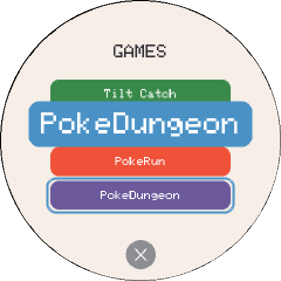 |
| **A buddy visits from another Knomi** | **Battle or trade with them** | **Press and slide to choose** |

## Install

You need a BTT Knomi V2, a USB-C data cable, and Chrome or Edge on a computer.

Don't have a Knomi yet? **[Get the BIGTREETECH Knomi V2](https://www.awin1.com/pclick.php?p=43148197656&a=2034499&m=95665)**. This is an affiliate link from [deals.3dprintsos.com](https://deals.3dprintsos.com): buying through it supports this project at no extra cost to you.

1. Plug in the Knomi.
2. Open the **[web installer](https://fedorsosnin.github.io/PokeKnomiGochi/)** and click **Install**.
3. Pick the USB serial port and wait a few minutes.

**Updating later:** run the installer again and leave **Erase device** unticked. That keeps your Pokémon and your Wi-Fi.

This replaces the printer-status firmware on the Knomi. To return to it, see [Going back to the stock firmware](#going-back-to-the-stock-firmware).

### Install without the browser

Download the files in [`web/knomi/firmware`](web/knomi/firmware), install [esptool](https://docs.espressif.com/projects/esptool/en/latest/esp32s3/installation.html), then run this from that folder with your own port name:

```bash
esptool --port YOUR_PORT write-flash 0x0 bootloader.bin 0x8000 partitions.bin 0xe000 boot_app0.bin 0x10000 firmware.bin 0x610000 sprites.bin
```

### If the install doesn't work

| Problem | Try this |
|---|---|
| No port appears | Use a different USB-C cable, because many only charge. On macOS or Windows you may also need the driver from the [CH340 page](https://www.wch-ic.com/products/CH340.html). |
| The port is busy | Close anything else using it, such as a serial monitor or Klipper. |
| It fails partway | Run it again. A failed install won't damage the Knomi. |
| The clock is wrong | The clock needs Wi-Fi. See [Wi-Fi and the clock](#wi-fi-and-the-clock). |

## How to play

The screen turns to follow however you hold the Knomi. It starts ready for your right hand with the cable going off to the left, so the button is under your finger.

See [How it works](docs/HOW_IT_WORKS.md) for charts of what every action, game and zone does.

| Do this | What happens |
|---|---|
| **Tap the Pokémon** | Pet it |
| **Tap the bottom icons** | Feed it, open games, turn the light off for bed, or give it a bath |
| **Press and slide** | The button under your finger shows large above it. Slide to another one if you missed, and lift to choose |
| **Swipe up** | See its stats |
| **Swipe left or right** | Open the Pokédex |
| **Swipe down** | Set the clock, then swipe left for settings |
| **Press the button** | Start a wild battle |
| **Hold the button for 1–3 seconds** | Turn the screen on or off |
| **Hold the button for 10 seconds** | Asks whether to erase the game and start over |

### Raising your next Pokémon

A fully evolved Pokémon that is at least 3 days old offers a goodbye, which you can put off as long as you like. You can also let any Pokémon go by holding your finger on it. Either way, you then choose your next one from any Pokémon in your Pokédex, with a 1 in 4 chance that it hatches shiny. If you neglect a Pokémon until it runs away, you get a random common egg instead.

### Battles and catching

Press the button to meet a wild Pokémon in a simple turn-based fight, inspired by the Game Boy games. Every Pokémon fights with its own moves from Pokémon Red and Blue and learns stronger ones as it levels up.

Winning trains your Pokémon. Losing leaves it nearly out of energy, so it has to sleep before it can fight again.

If you beat a Pokémon you haven't caught yet, you get three Poké Balls. Tap to throw, then lean the Knomi left and right to steer. A direct hit adds it to your Pokédex.

### Games

Tap the Poké Ball icon to open the menu. **Swipe up from the lower half of the screen to quit any game**, with nothing earned.

- **Battle:** pick a zone (Forest, Beach, Cave, Mansion or Field) and hunt the Pokémon that live there. Each zone shows what you've caught and what's still a silhouette. Fill a zone and its legendary starts to appear. The physical button still starts a random battle.
- **PokeDungeon:** explore a cave floor by floor. Tap toward where you want to step, or hold to keep walking. Walk into a wild Pokémon to attack it with your own best move, pick up berries to heal, and find the stairs. A better-trained Pokémon gets deeper.
- **PokeRun:** tap to jump over rocks and bushes in a forest that keeps getting faster. How long can you last?
- **Who's That Pokémon?:** name the silhouette, five rounds per game.
- **Tilt Catch:** lean left and right to catch falling berries.

### Buddies

If another PokeKnomiGochi joins the same Wi-Fi network, its Pokémon comes over to play and a "... is here!" button appears. Tap the button to open the buddy menu.

- **Battle:** a friendly match where each of you picks your own moves. It makes your Pokémon happy, with no training gained and no energy lost.
- **Trade:** each of you picks a Pokémon from your Pokédex, and a green dot marks ones your buddy doesn't have yet. Once you both confirm, each of you gets the other's entry and keeps your own.

To find each other, PokeKnomiGochis share their Pokémon's species, level and nickname and their Pokédex with other devices on the same network. Buddies work between Knomis and the Mac version, PokeMacGochi, in any mix.

### Daily visitor

Once a day, a wild Pokémon drops by to hang out with yours for a little while, then says goodbye.

### Wi-Fi and the clock

The Knomi has no clock battery, so it gets the time over Wi-Fi. If it was already on your network, it usually reconnects by itself.

To change networks, swipe down, swipe left, tap **Change Wi-Fi**, pick your network, and type the password on the screen. A new network is only saved once it connects.

The time zone is currently fixed to US Eastern time. You can set the clock by hand from the same screen.

### Updates over Wi-Fi

Once it's on Wi-Fi, the Knomi looks for a new version once a day while the screen is dimmed. To update, swipe down, swipe left, and tap **Check for update**. If a new version is out, the button changes to **Update to v…**: tap it and wait about a minute while it downloads and restarts. Your Pokémon, Pokédex and Wi-Fi are kept. If the new version ever fails to start, the Knomi goes back to the one it had.

## 3D-printed case

A Poké Ball case for the Knomi, ready to print in three colors. It's a remix: the front half comes from [Knomi V2 Creality K1 wall holder / table stand](https://www.printables.com/model/850244-knomi-v2-creality-k1-wall-holder-table-stand) by [Nastra](https://www.printables.com/@Nastra_283431) on Printables, and the button and rounded back are new. Both the original and this remix are shared under [CC BY-NC 4.0](https://creativecommons.org/licenses/by-nc/4.0/): free to print, share and remix with credit, but not to sell. Download [`PokeKnomiGochi-case.3mf`](print/PokeKnomiGochi-case.3mf).

| | |
|:--:|:--:|
|  | 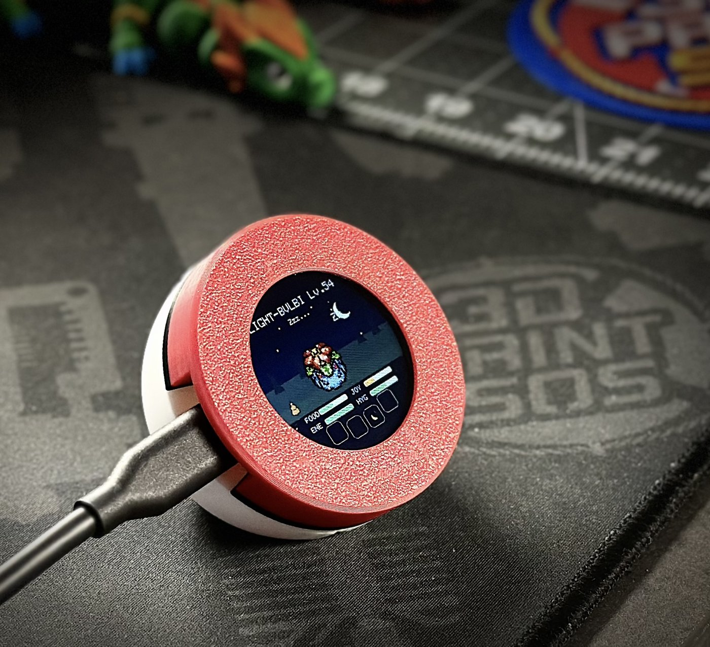 |
| **Printed and in hand** | **On the desk** |
| 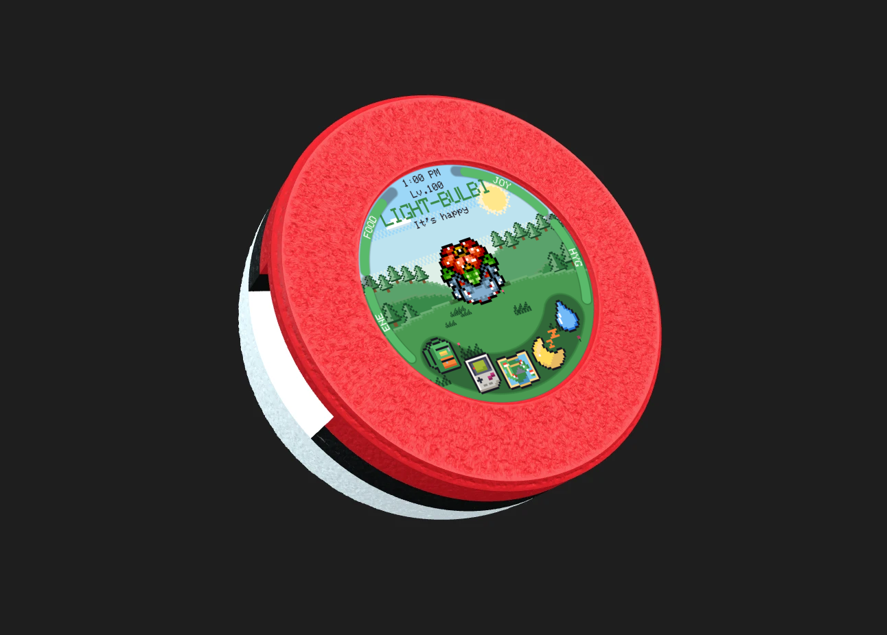 | 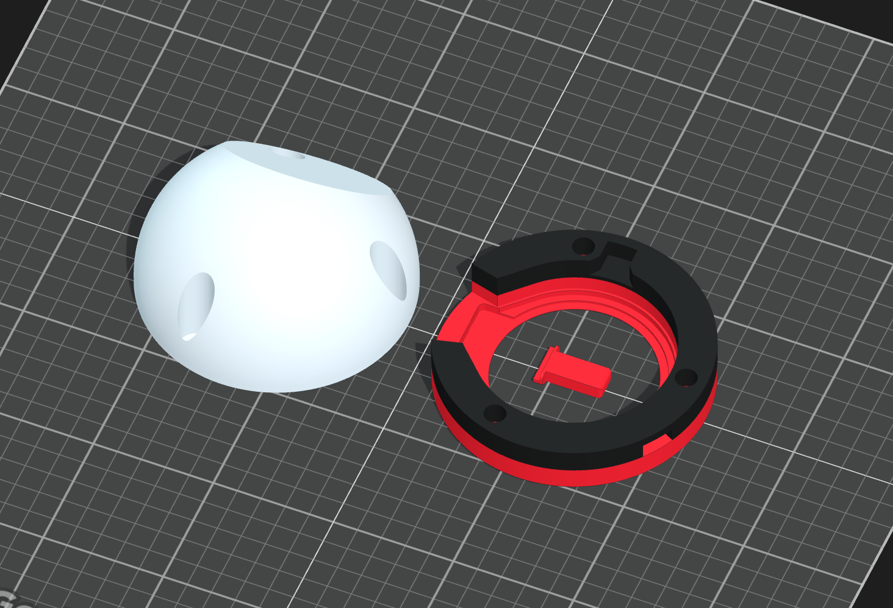 |
| **Render** | **Parts in their recommended colors** |

| Part | Recommended color | Size |
|---|---|---|
| Front ring and button | Red (`#D41721`) | 55 × 55 × 6 mm |
| Ball | White (`#FFFFFF`) | 55 × 55 × 29.3 mm |
| Band | Black (`#111111`) | 53.1 × 55 × 5.3 mm |

## Going back to the stock firmware

BIGTREETECH publishes the original firmware and instructions in its [KNOMI repository](https://github.com/bigtreetech/KNOMI). Installing it removes the game.

If you'd like an exact copy of your Knomi before you start, back it up first. The file includes any saved Wi-Fi password, so keep it private:

```bash
esptool --port YOUR_PORT read-flash 0 ALL knomi-backup.bin
```

## Build it yourself

The project builds with [arduino-cli](https://arduino.github.io/arduino-cli/) and ESP32 core 3.3.10. The folder has to be called `PokeKnomiGochi`, because Arduino requires the folder to match the sketch name.

```bash
git clone https://github.com/FedorSosnin/PokeKnomiGochi.git
```

```bash
cd PokeKnomiGochi
```

```bash
arduino-cli config init --additional-urls https://raw.githubusercontent.com/espressif/arduino-esp32/gh-pages/package_esp32_index.json
```

```bash
arduino-cli core update-index
```

```bash
arduino-cli core install esp32:esp32@3.3.10
```

```bash
arduino-cli lib install "GFX Library for Arduino" SensorLib XPowersLib U8g2
```

```bash
bash tools/build_knomi_web.sh
```

The build needs Python 3 and writes the flashable files to `web/knomi/firmware`. On a Mac, `tools/knomi_flash.sh` builds and flashes in one step.

Game rules run on your computer without a board:

```bash
./test/run_tests.sh
```

The code still supports the original Waveshare board that TamaPoke was made for. Its guide is in [`docs/TAMAPOKE-README.md`](docs/TAMAPOKE-README.md), and that document also explains the game's numbers in depth.

## PokeMacGochi (Mac)

The same game as a small round window on your Mac desktop, in a Poké Ball ring. It has no Dock icon; it lives in the menu bar.

1. Download `PokeMacGochi.dmg` from the [latest release](https://github.com/FedorSosnin/PokeKnomiGochi/releases), open it and drag **PokeMacGochi** to **Applications**.
2. Open it once. macOS warns that it can't check the app, because it isn't signed by an Apple developer account. Click **Done**.
3. Go to **System Settings → Privacy & Security**, scroll down and click **Open Anyway** next to PokeMacGochi. After that it opens normally.

   Or, in Terminal: `xattr -dr com.apple.quarantine /Applications/PokeMacGochi.app`

**Controls:** click, hold and swipe like a touch screen. The left and right arrows tilt, for Tilt Catch and throwing Poké Balls. Space is the Knomi's button, for a wild battle. Drag the ring to move the window. Right-click it, or click the Poké Ball in the menu bar, for About, Size, Mute Sound, Check for Updates and Quit.

Your pet, sound setting and window size and place are saved on the Mac in `~/Library/Application Support/PokeMacGochi`, separate from any Knomi. Only one copy runs on that save at a time: opening it again just tells you it's already open.

**Updates:** PokeMacGochi checks for a new version when it opens and once a day, and tells you once when one is out. **Download** gets the new DMG; quit PokeMacGochi, open the DMG and drag it into Applications, choosing **Replace**. Your pet stays, since it's saved outside the app.

**Buddies:** a Knomi or another PokeMacGochi on the same Wi-Fi shows up as a buddy, just like between two Knomis. The first time, macOS asks whether PokeMacGochi may find devices on your local network: click **Allow**. If you clicked **Don't Allow**, turn PokeMacGochi on in **System Settings → Privacy & Security → Local Network** and reopen it.

To build it yourself, run `mac/build_dmg.sh` (needs Xcode's Command Line Tools). [host/README.md](host/README.md) explains how it works.

## Credits and license

- **Game and original firmware:** [TamaPoke](https://github.com/socquique/TamaPoke) by Quique Tortosa and its contributors.
- **Sprites:** the community artists of [PMD SpriteCollab](https://github.com/PMDCollab/SpriteCollab), under CC BY-NC 4.0.
- **Full list:** [`CREDITS.md`](CREDITS.md).

The source code is [MIT licensed](LICENSE). The sprites and Pokémon names are not covered by that license and are for **personal, non-commercial use only**. The 3D-printed case is a remix shared under [CC BY-NC 4.0](https://creativecommons.org/licenses/by-nc/4.0/); see [`CREDITS.md`](CREDITS.md).

This is an unofficial fan project, not affiliated with or endorsed by Nintendo, Game Freak or The Pokémon Company. Pokémon and all related names are trademarks of their respective owners.
